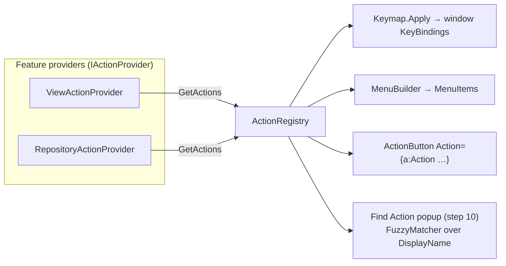

# Actions and fuzzy matching

How DevHub's action system (`src/DevHub.App/Actions/`) and the fuzzy matcher
(`src/DevHub.Core/Search/FuzzyMatcher.cs`) work, why they're built this way, and how to
extend them. Written for UI-0 step 5; steps 6 (menus/toolbar), 9 (keymap settings) and
10 (Find Action) build on both.

---

## Part 1: Actions

### The problem they solve

A real IDE does the same thing from many places. "Rescan repositories" can be:

- a toolbar button (icon + tooltip),
- a menu item (text + icon + shortcut hint),
- a context-menu item,
- a keyboard shortcut (F5),
- an entry in the Find Action popup (Ctrl+Shift+A, step 10).

Without a shared definition, each of those would wire up its own command, its own label,
its own icon and its own "is this allowed right now?" check, and they would drift apart:
the toolbar button greys out but the shortcut still fires, the menu says "Refresh" while
the tooltip says "Rescan", and so on.

An **action** is the single definition all of those read from. It's the same idea as
IntelliJ's `AnAction`, or Unity's `MenuItem` attribute plus the shortcut manager, folded
into one object.

### The pieces at a glance



| File | Role |
|---|---|
| `AppAction.cs` | One action: id, label, icon, shortcut, and the `ICommand` that runs it. |
| `ActionIds.cs` | `const string` ids so C# gets autocomplete and typo checks. |
| `IActionProvider.cs` | Interface each feature implements to contribute actions. |
| `ActionRegistry.cs` | Collects all providers' actions; lookup by id. |
| `Keymap.cs` | Turns shortcuts into window-wide `KeyBinding`s. |
| `Gestures.cs` | Parses "Alt+1"-style strings (works around an Avalonia bug). |
| `MenuBuilder.cs` | Builds `MenuItem`s / separators from a list of ids. |
| `ActionMarkupExtensions.cs` | `{a:Action}`, `{a:ActionMenu}`, `{a:ActionList}` for XAML. |
| `Providers/*.cs` | The actual actions, grouped by feature. |

### `AppAction`: what an action is

```csharp
new AppAction(ActionIds.RescanRepositories, "Rescan", repositories.ScanCommand)
{
    Category = "Repositories",
    IconKind = IconKind.Refresh,
    Gesture = "F5",
    Description = "Scan the chosen folders for git repositories again.",
};
```

| Property | Meaning |
|---|---|
| `Id` | Stable, `"Area.Verb"` style (`"Repositories.Rescan"`). Menus, keymaps and (later) saved settings refer to actions by id, so **don't rename ids casually**. |
| `Text` | Short label for menus and buttons. End it with "…" when the action opens a dialog ("Add Folder…"), same as JetBrains and Windows conventions. |
| `Command` | The `ICommand` that runs. Its `CanExecute` **is** the action's enabled state. |
| `Category` | Group for Find Action ("Repositories"). |
| `IconKind` | Optional icon name (`IconKind.Refresh`). |
| `Description` | Optional longer text for tooltips / Find Action. |
| `Gesture` | Optional shortcut string ("Ctrl+Shift+K", "F5", "Alt+1"). Settable, so a user keymap can override it later. |
| `DisplayName` | Computed: `"Category: Text"`. What Find Action will list and search. |
| `ToolTip` | Computed: `"Text (Gesture)"`, e.g. "Rescan (F5)". |

**Key design decision: an action wraps an existing `ICommand`.**
The Repositories page already had `ScanCommand` (generated by `[RelayCommand]`), with a
`CanScan()` rule: not while scanning, and only when at least one folder is chosen. The
action doesn't re-implement that. It hands out the *same* command object. Every control
bound to it (the page's own button, the toolbar button, the menu item, the F5 key binding)
asks the same `CanExecute` and gets told by the same `CanExecuteChanged` event. That's
why "Rescan" greys out everywhere at once.

How the enabled state flows, step by step:

1. The user adds a folder → `ScanFolders.CollectionChanged` fires in `RepositoriesViewModel`.
2. The ViewModel calls `ScanCommand.NotifyCanExecuteChanged()`.
3. The command raises `CanExecuteChanged`.
4. Avalonia's `Button`, `MenuItem` and `KeyBinding` are all listening; each calls
   `CanExecute()` again, gets `true`, and enables itself.

For actions that don't belong to a page, providers create a small command on the spot:
`new RelayCommand(() => theme.IsDark = !theme.IsDark)`.

`AppAction` contains no Avalonia types (the shortcut is a plain string), so ViewModels
and providers can create actions without referencing the UI layer.

### Providers: where actions come from

Each feature area owns a provider that knows its own actions:

```csharp
public sealed class RepositoryActionProvider(RepositoriesViewModel repositories) : IActionProvider
{
    public IEnumerable<AppAction> GetActions()
    {
        yield return new AppAction(ActionIds.AddScanFolder, "Add Folder…", repositories.AddFolderCommand) { … };
        yield return new AppAction(ActionIds.RescanRepositories, "Rescan", repositories.ScanCommand) { … };
    }
}
```

The provider gets what it needs (here the page ViewModel) through its constructor, like
everything else in the app. That `(RepositoriesViewModel repositories)` after the class
name is a C# 12 *primary constructor*: a shorter way to write a constructor that stores a
parameter.

Current providers:

| Provider | Actions |
|---|---|
| `ViewActionProvider` | `View.ToggleTheme` (Ctrl+Alt+D), `View.ToggleCompact` |
| `DocumentActionProvider` | one `Navigate.<DocumentId>` per document ("New Project…" Ctrl+N, …) and the tab actions `Editor.CloseTab` (Ctrl+F4), `Editor.NextTab` (Alt+Right), `Editor.PreviousTab` (Alt+Left). Added in UI-0 step 8, when pages became editor tabs. |
| `SettingsActionProvider` | `App.Settings` "Settings…" (Ctrl+Alt+S) opens the Settings dialog. Takes a `Func<SettingsDialogViewModel>` factory so each opening gets a fresh dialog. Added in UI-0 step 9. |
| `FindActionProvider` | `App.FindAction` "Find Action…" (Ctrl+Shift+A) opens the Find Action overlay. Uses a `Func<FindActionViewModel>` factory because the popup needs the registry that this provider is part of. Added in UI-0 step 10. |
| `RepositoryActionProvider` | `Repositories.AddFolder`, `Repositories.Rescan` (F5) |
| `ToolWindowActionProvider` | one `ToolWindow.<Title>` per tool window (Alt+1, Alt+2… in registration order, like JetBrains' Alt+1 = Project) and `ToolWindow.HideAll` (Ctrl+Shift+F12). Added in UI-0 step 7, which moved Alt+1… from pages to tool windows. |

The `Navigate.*` ids come from the document's `Id` (its ViewModel type name minus "ViewModel"):
`TemplatesViewModel` → `Navigate.Templates`, `GenerateViewModel` → `Navigate.Generate`.

### `ActionRegistry`: collecting them

Registration in `App.axaml.cs`:

```csharp
services.AddSingleton<IActionProvider, ViewActionProvider>();
services.AddSingleton<IActionProvider, RepositoryActionProvider>();
services.AddSingleton<IActionProvider, ToolWindowActionProvider>();
services.AddSingleton<IActionProvider, DocumentActionProvider>();
services.AddSingleton<IActionProvider, SettingsActionProvider>();
services.AddSingleton<IActionProvider, FindActionProvider>();
services.AddSingleton<ActionRegistry>();
```

Registering several classes under the **same** interface is a feature of
Microsoft.Extensions.DependencyInjection. When a constructor asks for
`IEnumerable<IActionProvider>`, the container passes *all* of them, in registration order.
The registry's constructor loops over them and builds a dictionary by id.

Two safety checks fail loudly at startup instead of misbehaving silently later:

- **Duplicate id** → `InvalidOperationException("Duplicate action id 'X' (from SomeProvider)")`.
- **Unknown id** in `Get(id)` → `KeyNotFoundException("Unknown action id 'X'. See ActionIds.")`.
  A typo in a menu definition is a bug, so it should crash in development, not show an
  empty menu.

### `Keymap`: shortcuts

`Keymap.Apply(registry, mainWindow)` runs once at startup. For every action with a
`Gesture`, it parses the string and adds a `KeyBinding` to the window:

```csharp
target.KeyBindings.Add(new KeyBinding { Gesture = gesture, Command = action.Command });
```

How Avalonia uses that: when a key is pressed, `KeyboardDevice` starts at the focused
control and walks **up** the visual tree to the window, checking each element's
`KeyBindings`. Bindings on the window therefore work wherever focus is inside it. A
`KeyBinding` also respects `CanExecute`, so F5 does nothing while Rescan is disabled.

It also checks for conflicts: if two actions claim the same shortcut, it throws
`"Shortcut 'F5' is assigned to both 'A' and 'B'."`, because only one of them could ever run.

#### The `Alt+1` bug (`Gestures.cs`)

Avalonia 12's `KeyGesture.Parse("Alt+1")` does **not** produce the digit-1 key. It falls
back to `Enum.TryParse<Key>("1")`, and `Enum.TryParse` accepts *numbers* as well as names,
so "1" becomes the enum member whose value is 1: `Key.Cancel`. The digit key is
`Key.D1` (value 35). The binding is created without error but never fires.

`Gestures.Parse` rewrites a lone trailing digit ("Alt+1" → "Alt+D1") before calling
Avalonia, so action definitions can keep the readable form. **Always use
`Gestures.Parse`, never `KeyGesture.Parse` directly.**

Display is fine: menus format `Key.D1` back to "1" (Avalonia's `KeyGestureFormatInfo` maps
`D0`…`D9` to digits), so menus show "Alt+1", not "Alt+D1". Verified in step 6.

### `MenuBuilder`: menus from ids

```csharp
MenuBuilder.Build(registry, ["Repositories.AddFolder", "Repositories.Rescan", "-", "View.ToggleTheme"]);
```

Each id becomes a `MenuItem` with the action's text, icon, shortcut hint and command.
Disabled state is automatic: a `MenuItem` with a `Command` greys itself out when
`CanExecute` is false.

`"-"` is a separator. Leading, trailing and doubled separators are **dropped**: the
builder only emits a separator once a real item follows it. That lets later code compose
menus from groups (e.g. "the git group" + "-" + "the view group") without checking
whether a group turned out empty.

### Using actions from XAML

XAML can't receive constructor injection, so three **markup extensions** look things up
in the DI container (`App.Services`) instead. A markup extension is a small class that XAML
calls while loading: writing `{a:Action View.ToggleTheme}` constructs
`ActionExtension("View.ToggleTheme")` and uses whatever its `ProvideValue` returns.

Declare the prefix once per file:

```xml
xmlns:a="clr-namespace:DevHub.Actions"
```

| Extension | Returns | Example |
|---|---|---|
| `{a:Action id}` | the `AppAction` | `<c:ActionButton Action="{a:Action Repositories.Rescan}" />` |
| `{a:ActionMenu 'id,-,id'}` | a list of `MenuItem`/`Separator` | `<ContextMenu ItemsSource="{a:ActionMenu 'Repositories.Rescan,-,View.ToggleTheme'}" />` |
| `{a:ActionList}` | every action | `<ItemsControl ItemsSource="{a:ActionList}">` |

`ActionButton` has an `Action` property. Setting it fills in `Command`, `IconKind` and
the tooltip ("Rescan (F5)") in one go, so a toolbar is just:

```xml
<c:Toolbar>
    <c:ActionButton Action="{a:Action Repositories.AddFolder}" />
    <c:ActionButton Action="{a:Action Repositories.Rescan}" />
    <c:ToolbarSeparator />
    <c:ActionButton Action="{a:Action View.ToggleTheme}" />
</c:Toolbar>
```

In the XAML previewer there is no DI container, so the extensions return "no value" /
an empty list instead of crashing.

**Why markup extensions and not ViewModel properties?** The obvious alternative, a
ViewModel exposing `ActionRegistry`, creates a dependency loop: the registry needs the
providers, `DocumentActionProvider` needs the `DocumentManager`, which needs every document
ViewModel, including the one that would want the registry. Reading the registry from XAML
sidesteps that.

### Keeping state in sync: `IThemeService.Changed`

Before actions existed, the theme only changed from the UI Gallery's own switches. Now
Ctrl+Alt+D can flip it from anywhere, so the gallery's "Dark" switch would show stale
state. `IThemeService` therefore raises a `Changed` event after any Dark/Light, Compact or
accent change. Two listeners:

- `UiGalleryViewModel` mirrors the new state into its switches (unsubscribes in `Dispose`).
- `App.axaml.cs` re-renders the window icon (unsubscribes when the window closes).

There's no infinite loop: setting an `[ObservableProperty]` to the value it already has
does nothing, and `ThemeService` ignores no-op changes (`if (value == IsDark) return;`).

### Recipe: adding an action

1. **Id**: add a constant to `ActionIds` (`public const string PushBranch = "Git.Push";`).
2. **Command**: make sure there's an `ICommand` for it. Usually a `[RelayCommand]` on the
   relevant ViewModel, with a `CanExecute` method if it isn't always allowed.
3. **Provider**: `yield return new AppAction(ActionIds.PushBranch, "Push…", git.PushCommand) { Category = "Git", IconKind = IconKind.Push, Gesture = "Ctrl+Shift+K" };`
   in the feature's provider. For a new feature area, create a new
   `IActionProvider` class and register it in `App.axaml.cs`
   (`services.AddSingleton<IActionProvider, GitActionProvider>();`).
4. **Use it**: `<c:ActionButton Action="{a:Action Git.Push}" />`, or add the id to a
   `{a:ActionMenu …}` list. The shortcut works automatically.
5. **Run the app.** A duplicate id or a clashing shortcut stops it at startup with a
   message naming both actions.

### Current limitations / what comes next

- **Global, not contextual.** An action can't yet ask "which repository is selected in
  the panel I was invoked from?". It only sees what its provider captured. When the Git
  tool window arrives, actions will need a small "data context" (current repository,
  current selection), like IntelliJ's `DataContext`.
- **Shortcuts aren't user-editable yet.** Step 9's Settings dialog will save overrides to
  `settings.json`, set `AppAction.Gesture`, and re-apply the keymap.
- **No visibility rule.** Actions can be disabled but not hidden. Add an `IsVisible`
  check only when a menu really needs it.

---

## Part 2: Fuzzy matching

### What it's for

The Find Action popup (step 10) lets you type a few letters and find an action by name,
like Ctrl+Shift+A in Rider or the Command Palette in VS Code. You won't type the exact
name. You'll type `gp` for "Git: Push", `rescan` for "Repositories: Rescan", or `tdt` for
"View: Toggle Dark Theme". The matcher answers two questions for every action:

1. **Does it match at all?**
2. **How good is the match?** (to sort the list, best first)

It also reports **which characters matched**, so the popup can highlight them.

It lives in **Core** (`DevHub.Core.Search`) because it's pure logic: strings in, numbers
out, no UI. That makes it easy to unit-test (`tests/DevHub.Core.Tests/FuzzyMatcherTests.cs`),
and keeps it reusable, e.g. for filtering templates or repositories later.

### API

```csharp
FuzzyMatch? match = FuzzyMatcher.Match(pattern: "gp", text: "Git: Push");
// match.Score     == 12
// match.Positions == [0, 5]   → G and P
```

- Returns `null` when the text doesn't match.
- An empty or whitespace-only pattern matches everything with score 0, so an empty search
  box shows the full list.
- Spaces in the pattern are ignored: "git push" behaves like "gitpush".
- Matching is case-insensitive; case doesn't change the score.
- `Score` is only meaningful **compared with other scores for the same pattern**. There's
  no absolute "good" number.

### Rule 1: does it match? (subsequence)

The pattern matches when all its characters appear in the text **in the same order**, but
not necessarily next to each other. That's called a *subsequence*.

| Pattern | Text | Match? | Why |
|---|---|---|---|
| `push` | Git: Push | yes | P-u-s-h appear in order |
| `gp` | Git: Push | yes | G … P |
| `gitpush` | Git: Push | yes | the space and colon are just skipped |
| `pg` | Git: Push | **no** | right letters, wrong order |
| `pushx` | Git: Push | **no** | there's no x |

### Rule 2: how good is it? (scoring)

There are usually *several* ways to line the pattern up with the text. For `cs` in
"Close Settings", the `s` could be the one in "Clo**s**e" or the one in "**S**ettings".
The scorer rates each possible alignment and keeps the best one. Every matched character
earns points depending on **where** it landed:

| Rule | Points | Constant |
|---|---|---|
| Every matched character | +1 | `MatchScore` |
| …and it's the first character of the text | +7 | `StartOfTextBonus` |
| …or it starts a word (see below) | +6 | `WordStartBonus` |
| …and it directly follows the previous matched character | +7 | `ConsecutiveBonus` |
| …otherwise, for each skipped character since the previous match | −1 each, at most −3 | `GapPenalty`, `MaxGapPenalty` |

A character **starts a word** when it comes:

- right after a space or one of `_ - . / : \ (`. Example: the P in "Git: **P**ush";
- as an upper-case letter right after a lower-case one (camelCase). Example: the W in "Open**W**ith";
- as a digit right after a letter. Example: the 2 in "Step**2**".

Skipped characters *before* the first match cost nothing. Typing "push" shouldn't be
punished because "Git: " comes first.

The intent behind the numbers:

- **Word starts matter.** People type initials ("gp", "tdt"), so letters that begin words
  are worth much more than letters in the middle of a word.
- **Runs matter more.** If you typed a whole word, a place where that word appears intact
  should win.
- **Gaps only break ties.** The penalty is small and capped, so a long name isn't
  punished just for being long.

### Worked examples

All scores below are what the real code returns (checked by running it).

**`gp` in "Git: Push" → 12, positions [0, 5]**

| Char | Lands on | Points |
|---|---|---|
| g | **G** (index 0, start of text) | 1 + 7 = 8 |
| p | **P** (index 5, word start after a space), 4 characters skipped (`it: `) | 1 + 6 − 3 = 4 |
| | | **12** |

**`cs` in "Close Settings" → 12, positions [0, 6]**

Here the choice matters. There are two candidate `s` characters:

| Option | c | s | Total |
|---|---|---|---|
| s in "Clo**s**e" (index 3, mid-word, 2 skipped) | 8 | 1 − 2 = −1 | 7 |
| s in "**S**ettings" (index 6, word start, 5 skipped → capped at −3) | 8 | 1 + 6 − 3 = 4 | **12** ✓ |

A simple left-to-right "take the first `s` you see" approach (*greedy*) would pick
"Clo**s**e" and score 7. That's why the matcher compares all alignments (see the next
section).

**`theme`: "Toggle Theme" (39) beats "The Merge" (38)**

| Text | Alignment | Score |
|---|---|---|
| Toggle **Theme** | T word start (1+6) + h, e, m, e each consecutive (4 × (1+7)) | 7 + 32 = **39** |
| **The** **Me**rge | T start of text (1+7) + h, e consecutive (2 × 8) + M word start, 1 skipped (1+6−1) + e consecutive (8) | 8 + 16 + 6 + 8 = **38** |

This was a real bug caught by the tests. With the first weights (consecutive +5, start of
text +8), "The Merge" won, 33 to 31. Raising the consecutive bonus to 7 fixed it, and it
also explains why that constant is the largest.

**`push`: "Push" (32) beats "Git: Push" (31)**

Same four consecutive letters, but in "Push" the P is the start of the text (+7) rather
than just a word start (+6). That one-point difference is the reason start-of-text is
7 and word start is 6: an exact prefix should rank first.

**`scan`: a known close call**

| Text | Score | Positions |
|---|---|---|
| **Scan** Repositories | 32 | [0,1,2,3] (prefix, all consecutive) |
| Re**scan** Repositories | 25 | [2,3,4,5] (run, but mid-word) |
| **S**how **C**hanges **An**d Notes | 24 | [0,5,13,14] (initials + a run) |

Initials and an in-word run come out almost equal, and the run wins by one point.
JetBrains tends to favour initials here. Both are defensible, so no test locks either
behaviour in.

**Decision (step 10):** left as is. With the real action names the case doesn't come up:
no two actions compete as "initials vs. in-word run", and the queries tried in the running
app ranked sensibly ("tdt" → Toggle Dark Theme, "tab" → Next / Close / Previous Tab,
"repo" → Repositories first). Revisit only if a real search ranks badly; add it as a test first.

### How it finds the best alignment (dynamic programming)

Checking every possible alignment one by one would explode: a 5-letter pattern in a
40-character name has thousands of combinations. The matcher uses **dynamic programming**
instead. It builds a table where each cell stores the best answer to a small sub-question,
and each answer reuses earlier ones, so nothing is computed twice.

With the pattern `p` (length *m*) and the text `t` (length *n*):

> `best[i, j]` = the best score for matching pattern characters `0..i`,
> **with pattern character `i` placed exactly at text index `j`**.
> Empty (no match) if `p[i]` ≠ `t[j]` or it's impossible.

Filling it in:

1. **First pattern character (row 0):** for every `j` where `t[j]` equals `p[0]`:
   `best[0, j] = 1 + position bonus(j)`. No gap penalty for the leading part.
2. **Every later character (rows 1…m−1):** for every `j` where `t[j]` equals `p[i]`, look at
   every earlier position `k < j` where row `i−1` has a score, and take the best of:
   `best[i−1, k] + 1 + position bonus(j) + link(k, j)`,
   where `link` is +7 if `k = j−1` (consecutive), otherwise `−min(j−k−1, 3)` (gap).
   Remember which `k` won in a second table, `from[i, j]`.
3. **Answer:** the highest score in the last row. If the last row is empty, there's no match.
4. **Positions:** start from the winning cell and follow `from` backwards to recover where
   each pattern character landed.

The table for `cs` in "Close Settings" (only cells where the letters match are filled in):

| | C(0) | l | o | s(3) | e | ␣ | S(6) | e | t | t | i | n | g | s(13) |
|---|---|---|---|---|---|---|---|---|---|---|---|---|---|---|
| **c** | **8** | | | | | | | | | | | | | |
| **s** | | | | 7 | | | **12** | | | | | | | 6 |

The best cell in the last row is 12 at index 6; `from[1, 6] = 0`, so the positions are [0, 6].

The work is roughly *m × n × n* steps. For action names (under ~60 characters) and typed
patterns (a few characters) that's a few thousand cheap operations per action. That's fine
for a few hundred actions per keystroke. If it ever matters (e.g. matching thousands of
file paths), the inner `k` loop can be replaced by a running maximum.

### Tuning the weights safely

The constants are `internal const` in `FuzzyMatcher`. If a real-world search ranks
something badly:

1. Add the case to `Ranks_better_candidate_higher` in `FuzzyMatcherTests.cs` as
   `[InlineData(pattern, better, worse)]`. It fails first, which proves the problem.
2. Adjust a weight.
3. Run `dotnet test`. All the existing ranking cases must still pass, which stops a fix for
   one search from quietly breaking another (exactly what happened with "theme").

The failure message prints both scores, e.g.
`'theme': 'Toggle Theme' scored 31, 'The Merge' scored 33`, so you can see by how much it
lost.

### How Find Action uses it (step 10)

`ViewModels/Shell/FindActionViewModel.cs`, opened with Ctrl+Shift+A:

1. **Match the name first:** `FuzzyMatcher.Match(query, action.Text)`.
2. **Then the category:** if the name alone doesn't match, try `"Category: Text"` (the
   `DisplayName`), so "repo rescan" still finds Rescan. Such matches score 10 points lower,
   and only the positions inside the name are kept for highlighting.
3. **Sort:** score (best first), then enabled before disabled, then shorter names, then
   A–Z. At most 50 rows; an empty query lists everything.
4. **Highlight:** `FindActionItem` splits the name into runs of matched / unmatched
   characters (`TextSegment`), shown as a row of TextBlocks with the matched ones bold
   and accent-coloured.
5. **Run:** Enter (or a click) closes the popup, then runs `Action.Command`. A disabled
   action is listed, greyed out, and does nothing when chosen, the way JetBrains does it.

The popup leaves out its own action ("Find Action…").
